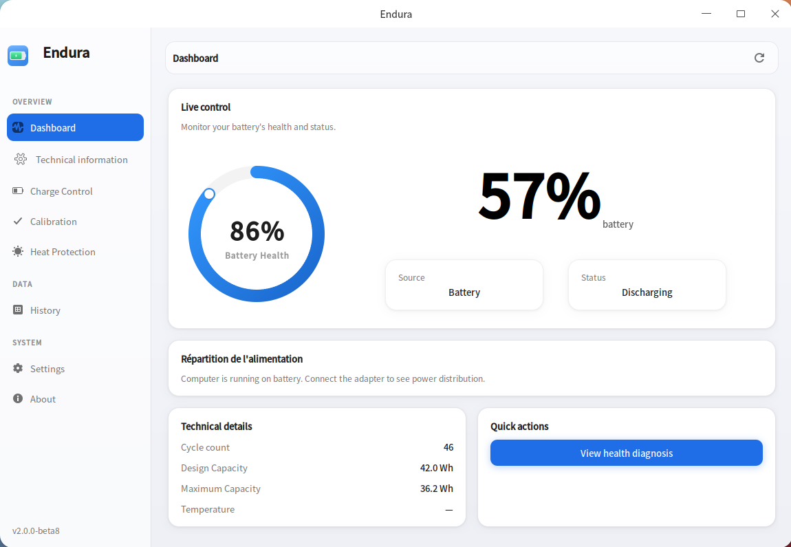

Endura

Endura centralizes battery monitoring, charge limit management, and thermal protection so your laptop stays healthy for longer. For Deepin Linux

I’m excited to share Endura, a native GTK3 application I’ve been working on specifically for Deepin Linux.

My goal with Endura is simple: give you full control over your laptop's battery to extend its lifespan.

Key Features:

Real-time Monitoring: Track health, capacity, voltage, and temperature with live charts.

Charge Limiter: Set a charge limit (e.g., 80%) to prevent wear and tear.

Sailing Mode: Keep your battery in an optimal range (e.g., 75-80%) to avoid micro-cycling (if supported by your hardware).

Heat Protection: Automatically reduces the charge limit if the battery temperature gets too high.

Calibration: A guided process to recalibrate your battery for accurate readings.

History & Trends: A background daemon logs your battery data 24/7 so you can view detailed history and trends.

Native Deepin Integration: Follows the system theme (light/dark) and integrates with D-Bus for notifications.

🌍 Multilingual Support:
The app is fully translated into 8 languages: German, English, Spanish, French, Japanese, Portuguese, Thai, and Chinese.

🚀 Why I need your help:
I’m currently in the final stages of beta testing (v1.0.0-betaXX). Before the final release, I would love to get feedback from real users on real hardware.

I am looking for beta testers to help me identify bugs, test the hardware compatibility (especially the charge limiter on different laptop models), and report any translation issues.

website : https://coatimundiapps.github.io/
